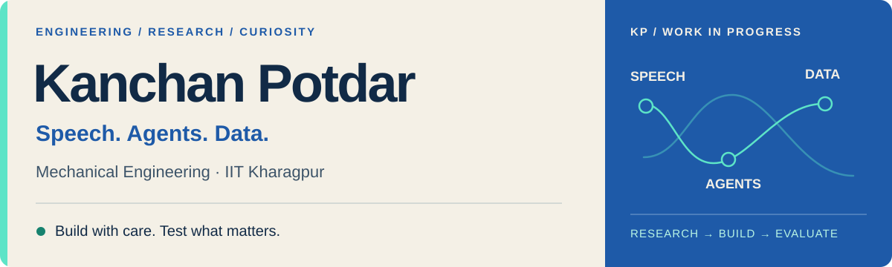

**From careful datasets to working AI systems.**

[Current work](#current-work) · [Selected builds](#selected-builds) · [Beyond the code](#beyond-the-code) · [My koi pond](#my-koi-pond)

## Hi, I'm Kanchan

I'm a **fourth-year Mechanical Engineering student at IIT Kharagpur** building across speech AI, language models, and data engineering. My research experience at **ISI Kolkata**, working on remaining useful life modelling, connects my engineering background with machine learning for real systems.

I enjoy the work between a promising idea and a result I can trust: understanding the data, building a baseline, investigating failures, and making the next experiment reproducible.

## Current work

### [Nyishi speech-to-IPA research](https://github.com/kanchanpotdar/BTP)

My bachelor's thesis project: a reproducible speech recognition pipeline for Nyishi Narration data using IPA transcriptions and IPA-Whisper. The work covers audio curation, careful transcript handling, and speaker/session separation.

**Where it stands:** splits frozen; processor and model smoke checks complete. A zero-shot validation CER baseline is next, before fine-tuning and final test evaluation.

### [VoiceEnterprise](https://github.com/kanchanpotdar/voicenterprise)

An enterprise RAG and voice prototype bringing together hybrid retrieval, cited answers, and a spoken interface. I'm interested in how retrieval choices, evidence handling, and latency affect the system people actually use.

**Focus:** retrieval, evaluation, and the path from a spoken question to a grounded response.

### [My ChatGPT Skills](https://github.com/kanchanpotdar/My-ChatGPT-Skills)

A growing collection of reusable AI workflows: prompt optimization, visual explanations, idea refinement, research reports, and active-recall tutoring. This is where I turn useful ways of working into repeatable tools.

**Focus:** clearer instructions, useful outputs, and workflows that improve through use.

## Recently built

**[BeyondBot TDS Review Agent](https://github.com/kanchanpotdar/BeyondBot-Assignment)** — a Python CLI prototype combining LLM-led investigation with deterministic calculations, evidence validation, and voucher-level coverage tracking. Its published evaluation covers part of the ledger; it is a prototype with explicit review limits.

## Selected builds

| Project | What I explored |
| --- | --- |
| [OpenAQ Medallion](https://github.com/kanchanpotdar/openaq_medallion) | An auditable India PM2.5 pipeline with PostgreSQL Bronze → Silver → Gold layers, data-quality rules, and reconciliation. |
| [Financial Research Agent](https://github.com/kanchanpotdar/Financial-Research-Agent) | A LangGraph research workflow with parallel analysis, structured outputs, and a human approval step. |
| [Local Investment RAG](https://github.com/kanchanpotdar/cfa-rag) | Hybrid search, reranking, source passages, and streamed answers over finance curriculum documents. |
| [Cricket Match Simulation](https://github.com/kanchanpotdar/Monte-Carlo-Simulation-of-Cricket-Match-Outcomes) | Ball-by-ball T20 simulation with Markov chains and Monte Carlo experiments. |

## My working toolkit

- **Models & research:** Python, PyTorch, Whisper, Transformers, time-series modelling, and model evaluation.
- **Agents & retrieval:** LangGraph, RAG, Qdrant, embeddings, reranking, and structured outputs.
- **Data & delivery:** SQL, PostgreSQL, pandas, FastAPI, Streamlit, Docker, and GitHub Actions.

I care about **data provenance, reproducible experiments, and honest evaluation**. A useful diagnostic is a starting point for the next experiment.

## Beyond the code

- **In the pool:** Inter-IIT aquatics gold medallist.
- **In a team:** TFPS Governor, with experience leading a 120+ member society and managing a ₹5 lakh budget.
- **In competition:** top 0.5% in the American Express Decision Science challenge, among 6,500+ teams.

The same mix of patience, iteration, and teamwork shows up in how I build.

---

## My koi pond

**A little more code. A little bigger koi.**

FED BY PUBLIC COMMITS · REFRESHED DAILY

[How it grows](./docs/commit-koi.md) · [Latest commit count](./koi/stats.json) · [Git Koi](https://github.com/yalongwastaken/git-koi)

<b>After hours: the contribution arcade</b>

### Pac-Man

<picture>
  <source media="(prefers-color-scheme: dark)" srcset="https://raw.githubusercontent.com/kanchanpotdar/kanchanpotdar/output/pacman-contribution-graph-dark.svg">
  <source media="(prefers-color-scheme: light)" srcset="https://raw.githubusercontent.com/kanchanpotdar/kanchanpotdar/output/pacman-contribution-graph.svg">
  
</picture>

### Snake

### Breakout

<picture>
  <source media="(prefers-color-scheme: dark)" srcset="https://raw.githubusercontent.com/kanchanpotdar/kanchanpotdar/output/breakout-contribution-graph-dark.svg">
  <source media="(prefers-color-scheme: light)" srcset="https://raw.githubusercontent.com/kanchanpotdar/kanchanpotdar/output/breakout-contribution-graph.svg">
  
</picture>

---

[Explore all my repositories](https://github.com/kanchanpotdar?tab=repositories)

MECHANICAL ROOTS · APPLIED AI · ALWAYS LEARNING

