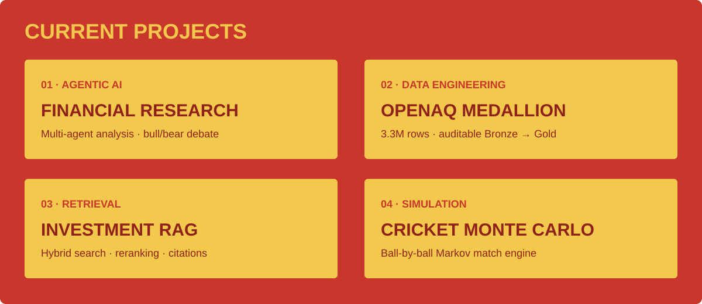
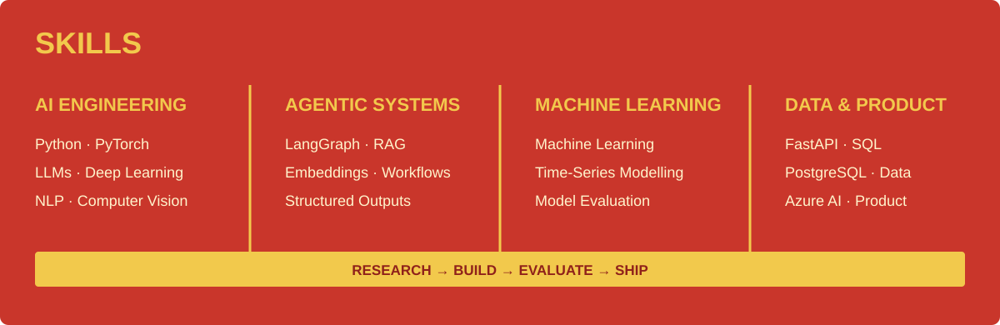
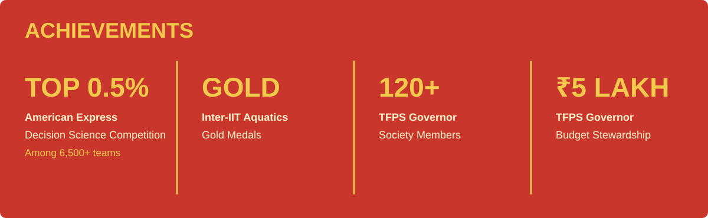

**Building practical AI systems from research to production.**

## Identity Core

---

## About Me

I’m a **Fourth-Year Mechanical Engineering Student at IIT Kharagpur** building practical AI systems across LLMs, machine learning, and data engineering. Through research, internships, and independent projects—including work with the **Indian Statistical Institute, Kolkata** on Remaining Useful Life—I turn technical ideas into grounded agentic workflows, reliable models, APIs, and auditable data products.

---

## Current Projects

[Financial Research Agent](https://github.com/kanchanpotdar/Financial-Research-Agent) · [OpenAQ Medallion](https://github.com/kanchanpotdar/openaq_medallion) · [Investment RAG](https://github.com/kanchanpotdar/cfa-rag) · [Cricket Simulation](https://github.com/kanchanpotdar/Monte-Carlo-Simulation-of-Cricket-Match-Outcomes)

---

## Skills

---

## Achievements

---

## Contribution Arcade

### Pac-Man Contribution Map

<picture>
  <source media="(prefers-color-scheme: dark)" srcset="https://raw.githubusercontent.com/kanchanpotdar/kanchanpotdar/output/pacman-contribution-graph-dark.svg">
  <source media="(prefers-color-scheme: light)" srcset="https://raw.githubusercontent.com/kanchanpotdar/kanchanpotdar/output/pacman-contribution-graph.svg">
  
</picture>

<b>LOAD BONUS ARCADE MODES</b>

 

<picture>
  <source media="(prefers-color-scheme: dark)" srcset="https://raw.githubusercontent.com/kanchanpotdar/kanchanpotdar/output/breakout-contribution-graph-dark.svg">
  <source media="(prefers-color-scheme: light)" srcset="https://raw.githubusercontent.com/kanchanpotdar/kanchanpotdar/output/breakout-contribution-graph.svg">
  
</picture>

---

[Explore all repositories](https://github.com/kanchanpotdar?tab=repositories)

RETRO EDITION · RED × YELLOW

