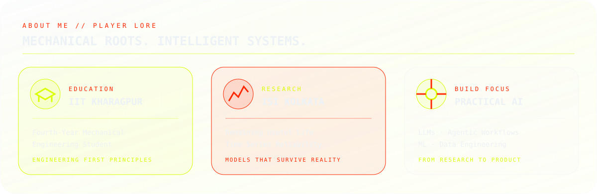
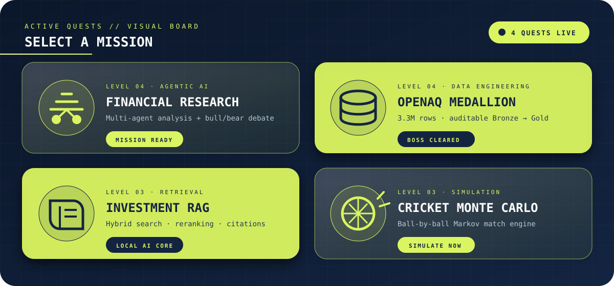
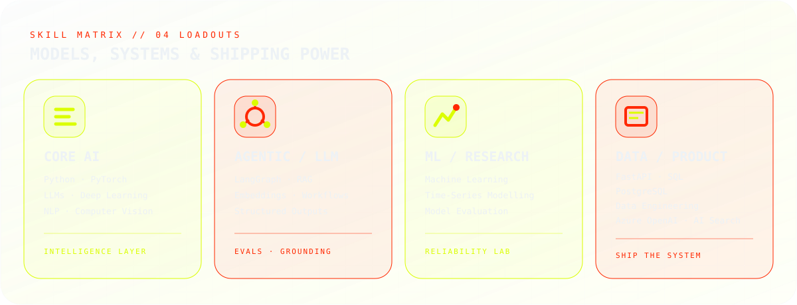
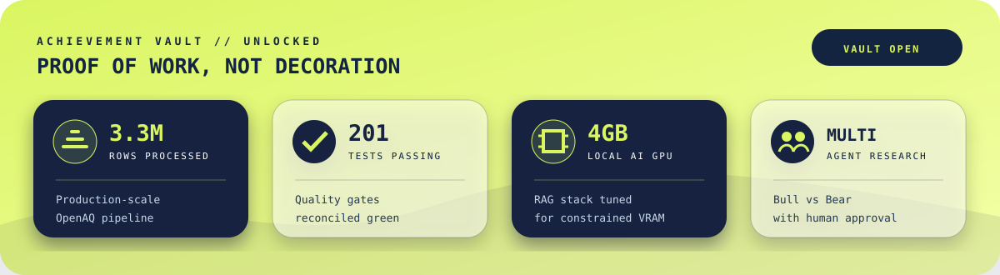

## `// IDENTITY CORE`

---

## `// ABOUT ME`

I’m a **Fourth-Year Mechanical Engineering Student at IIT Kharagpur** building practical AI systems across LLMs, machine learning, and data engineering. Through research, internships, and independent projects—including work with the **Indian Statistical Institute, Kolkata** on Remaining Useful Life—I turn technical ideas into grounded agentic workflows, reliable models, APIs, and auditable data products.

---

## `// ACTIVE QUEST BOARD`

---

## `// SKILL MATRIX`

---

## `// ACHIEVEMENT VAULT`

---

## `// CONTRIBUTION SIGNAL`

### `PAC-MAN // LIVE CONTRIBUTION MAP`

<picture>
  <source media="(prefers-color-scheme: dark)" srcset="https://raw.githubusercontent.com/kanchanpotdar/kanchanpotdar/output/pacman-contribution-graph-dark.svg">
  <source media="(prefers-color-scheme: light)" srcset="https://raw.githubusercontent.com/kanchanpotdar/kanchanpotdar/output/pacman-contribution-graph.svg">
  
</picture>

<b>LOAD BONUS ARCADE MODES</b>

 

<picture>
  <source media="(prefers-color-scheme: dark)" srcset="https://raw.githubusercontent.com/kanchanpotdar/kanchanpotdar/output/breakout-contribution-graph-dark.svg">
  <source media="(prefers-color-scheme: light)" srcset="https://raw.githubusercontent.com/kanchanpotdar/kanchanpotdar/output/breakout-contribution-graph.svg">
  
</picture>

---

GLASS INTERFACE // ACID <code>#DBFE01</code> × SIGNAL <code>#FF2801</code> × ICE <code>#EDF2F6</code>

