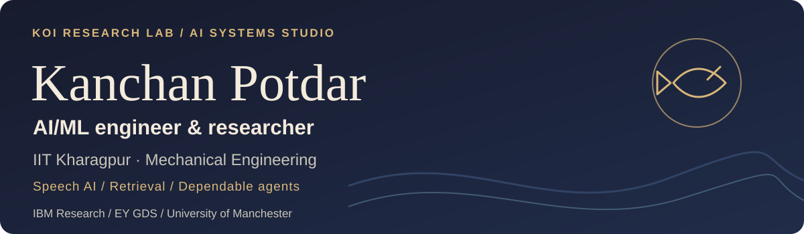
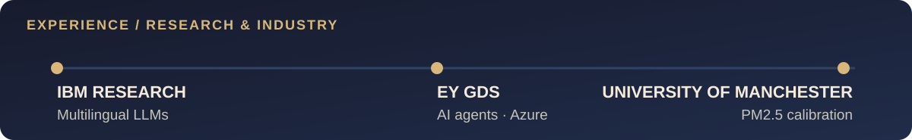
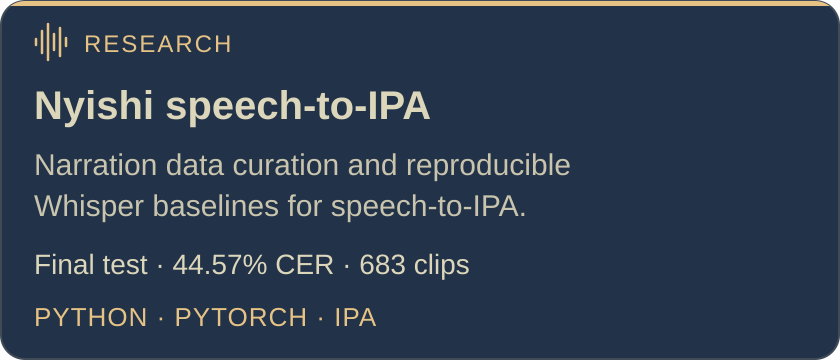
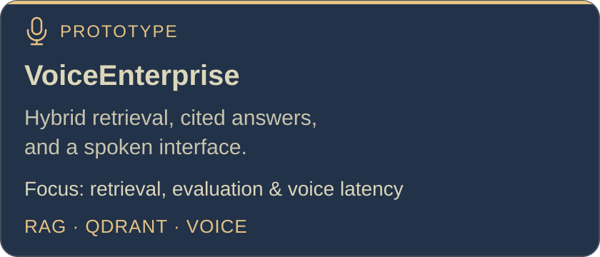
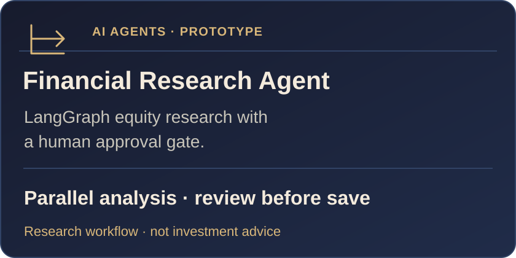
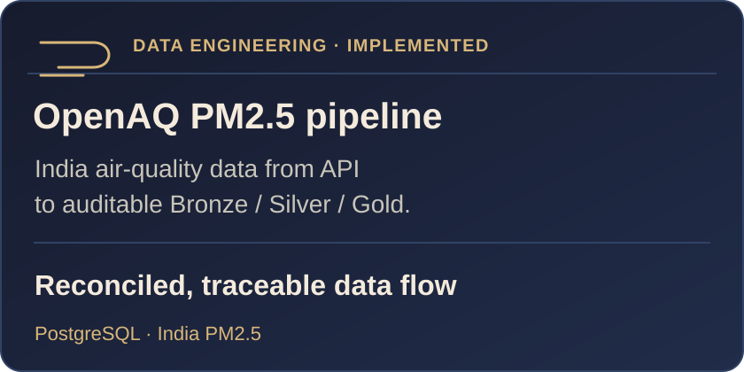
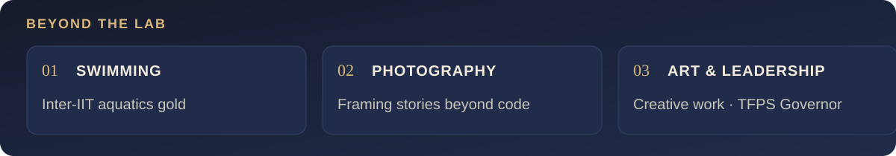
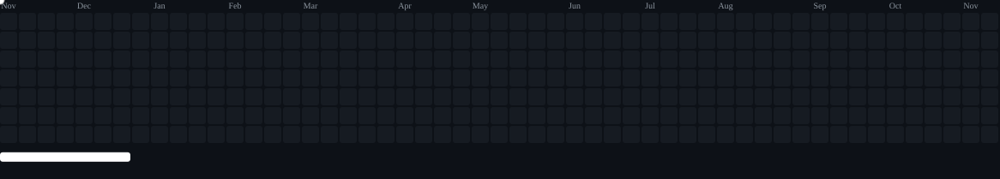

<picture>
  <source media="(max-width: 600px)" srcset="./assets/koi-lab/banner-mobile.svg">
  
</picture>

**I build AI systems with a research habit: trace the data, test the claim, and make the result useful.**

[Experience](#experience) · [Featured work](#featured-work) · [Research notebook](#research-notebook) · [Koi pond](#the-koi-pond) · [Beyond the lab](#beyond-the-lab) · [Contact](#contact)

## About

I'm **Kanchan Potdar**, a Mechanical Engineering student at **IIT Kharagpur** working across speech AI, retrieval, AI agents, and data systems. My research and industry experience spans multilingual LLMs, agent workflows on Azure, and air-quality calibration. I care about reproducible experiments, grounded outputs, and knowing where a system's evidence ends.

## Experience

<picture>
  <source media="(max-width: 600px)" srcset="./assets/koi-lab/experience-mobile.svg">
  
</picture>

IBM Research · multilingual LLMs &nbsp; / &nbsp; EY GDS · AI agents and Azure &nbsp; / &nbsp; University of Manchester · PM2.5 calibration

## Featured work

The cards distinguish a held-out result, a development retrieval benchmark, and implemented prototypes. Each links to the project record.

<!-- PROJECT_CARDS:START -->

<!-- PROJECT_CARDS:END -->

<b>Methods, evidence, and current stage</b>

### [Nyishi speech-to-IPA](https://github.com/kanchanpotdar/BTP)

Low-resource ASR for Nyishi Narration using IPA transcriptions. The study froze a speaker/session-aware split, selected a full fine-tuned IPA-Whisper checkpoint on validation CER, then evaluated it once on **683 held-out test clips**. The [public report](https://github.com/kanchanpotdar/BTP) records **44.57% test CER** versus **101.23%** for its zero-shot baseline. Lower CER is better; the remaining errors and label uncertainty are part of the result.

### [VoiceEnterprise](https://github.com/kanchanpotdar/voicenterprise)

An enterprise retrieval and voice **prototype** with provenance-aware ingestion and hybrid search. Its [Phase 1 development benchmark](https://github.com/kanchanpotdar/voicenterprise) reports **85.09% document Recall@5** for dense + BM25 reciprocal-rank fusion on **178 eligible development questions** against a **10,000-document subset**. This is a retrieval metric in that setting; it is not end-to-end answer quality or production performance. The broader evaluation still needs careful reruns before drawing answer-quality conclusions.

### [Financial Research Agent](https://github.com/kanchanpotdar/Financial-Research-Agent)

A LangGraph **prototype** that gathers company data and categorized news, runs parallel risk and growth analysis, stages a Bull/Bear discussion, and requires human approval before saving a research brief. The repository currently describes manual verification and no automated test suite, so no test-count badge is shown here.

### [OpenAQ India PM2.5](https://github.com/kanchanpotdar/openaq_medallion)

An **implemented** data pipeline for India PM2.5 measurements: immutable Bronze ingestion, rule-based Silver validation, Gold summaries, and audit reconciliation in PostgreSQL. Its [project documentation](https://github.com/kanchanpotdar/openaq_medallion#testing) describes isolated tests, an independent oracle, and mutation checks. The pipeline reports data quality and coverage explicitly rather than turning missing readings into clean-looking averages.

## Research notebook

A compact record of questions I'm working through. Edit [`scripts/profile_content.json`](scripts/profile_content.json) and run `python3 scripts/render_profile.py` to refresh this section and the project cards.

<!-- CURRENTLY_EXPLORING:START -->
- **Nyishi ASR:** error analysis after the sealed test.
- **Chronos-2 / FARSS:** time-series foundation models and reliability.
- **Enterprise retrieval:** evaluation quality and grounded answers.
- **Dependable AI agents:** coverage, evidence, and human review.
<!-- CURRENTLY_EXPLORING:END -->

**Working toolkit**

<kbd>Python</kbd> <kbd>PyTorch</kbd> <kbd>Transformers</kbd> <kbd>LangGraph</kbd> <kbd>Qdrant</kbd> <kbd>PostgreSQL</kbd> <kbd>SQL</kbd> <kbd>Docker</kbd> <kbd>GitHub Actions</kbd>

These are tools used across the linked projects, not a claim of expertise in every part of their ecosystems.

## The koi pond

**A little more code. A little bigger koi.**

[How it grows](./docs/commit-koi.md) · [Latest count](./koi/stats.json) · [Git Koi](https://github.com/yalongwastaken/git-koi)

The pond is refreshed by its existing daily workflow. It reflects public commits under the [documented counting rules](./docs/commit-koi.md), not every kind of GitHub activity.

## Beyond the lab

<picture>
  <source media="(max-width: 600px)" srcset="./assets/koi-lab/achievements-mobile.svg">
  
</picture>

- **Swimming:** Inter-IIT aquatics gold medals.
- **Photography and art:** visual storytelling alongside engineering work.
- **Leadership:** TFPS Governor; led a 120+ member society and managed a ₹5 lakh budget.
- **Competition:** top **0.5%** among 6,500+ teams in the American Express Decision Science challenge.

<b>After hours · contribution arcade</b>

### Pac-Man

<picture>
  <source media="(prefers-color-scheme: dark)" srcset="https://raw.githubusercontent.com/kanchanpotdar/kanchanpotdar/output/pacman-contribution-graph-dark.svg">
  <source media="(prefers-color-scheme: light)" srcset="https://raw.githubusercontent.com/kanchanpotdar/kanchanpotdar/output/pacman-contribution-graph.svg">
  
</picture>

### Snake

### Breakout

<picture>
  <source media="(prefers-color-scheme: dark)" srcset="https://raw.githubusercontent.com/kanchanpotdar/kanchanpotdar/output/breakout-contribution-graph-dark.svg">
  <source media="(prefers-color-scheme: light)" srcset="https://raw.githubusercontent.com/kanchanpotdar/kanchanpotdar/output/breakout-contribution-graph.svg">
  
</picture>

## Contact

For research collaboration or applied AI work, connect on [LinkedIn](https://www.linkedin.com/in/kanchan-potdar-8b4762289/) or explore my [GitHub repositories](https://github.com/kanchanpotdar?tab=repositories).

KOI RESEARCH LAB · AI SYSTEMS STUDIO · BUILD WITH EVIDENCE

